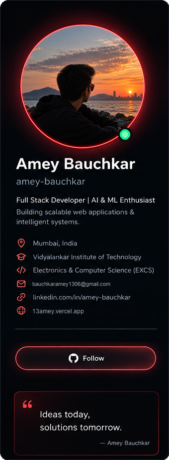
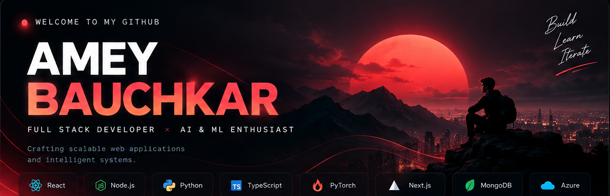
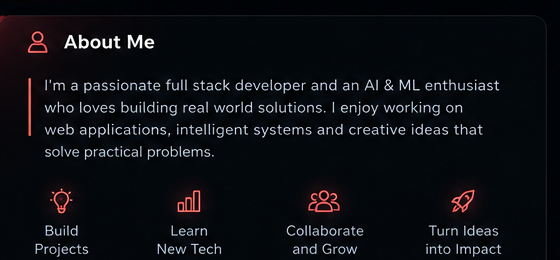
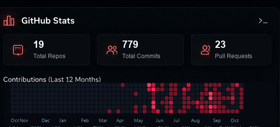
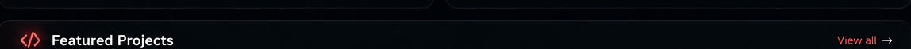
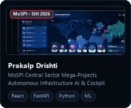
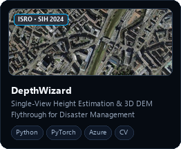
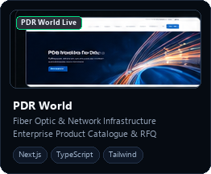
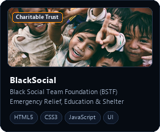

<!-- ========================================== -->
<!-- 🔴 NEON CRIMSON DEVELOPER DASHBOARD        -->
<!-- ========================================== -->

<table border="0" cellpadding="0" cellspacing="12" width="100%" style="border-collapse: separate; border-spacing: 12px; background: transparent;">
  <tr>
    <!-- LEFT SIDEBAR: PROFILE & ABOUT -->
    <td width="26%" valign="top" style="border: none; padding: 0;">
      
    </td>

    <!-- RIGHT COLUMN: HERO BANNER, ABOUT, STATS, & PROJECTS -->
    <td width="74%" valign="top" style="border: none; padding: 0;">
      
      <!-- HERO BANNER -->
      

        

      <!-- MIDDLE ROW: ABOUT ME & GITHUB STATS -->
      <table border="0" cellpadding="0" cellspacing="8" width="100%" style="border-collapse: separate; border-spacing: 8px; background: transparent;">
        <tr>
          <td width="49%" valign="top" style="border: none; padding: 0;">
            
          </td>
          <td width="2%" style="border: none;"></td>
          <td width="49%" valign="top" style="border: none; padding: 0;">
            
          </td>
        </tr>
      </table>

       

      <!-- FEATURED PROJECTS ROW -->
      <table border="0" cellpadding="0" cellspacing="8" width="100%" style="border-collapse: separate; border-spacing: 8px; background: transparent;">
        <tr>
          <td colspan="4" style="border: none; padding: 0 0 6px 0;">
            
          </td>
        </tr>
        <tr>
          <td width="25%" valign="top" style="border: none; padding: 0;">
            
          </td>
          <td width="25%" valign="top" style="border: none; padding: 0;">
            
          </td>
          <td width="25%" valign="top" style="border: none; padding: 0;">
            
          </td>
          <td width="25%" valign="top" style="border: none; padding: 0;">
            
          </td>
        </tr>
      </table>

    </td>
  </tr>
</table>

 

<!-- ========================================== -->
<!-- ⚡ INTERACTIVE & DYNAMIC SECTIONS          -->
<!-- ========================================== -->

<!-- Dynamic Typing Subtitle -->

  

<!-- Quick Connect & Status Badges -->

  
  
  
  

---

### 🛠️ Tech Stack & Arsenal

  

 

<table>
  <tr>
    <td width="50%" valign="top">
      <h4>💻 Frontend & Languages</h4>
      
      
      
      
      
      
      
      
    </td>
    <td width="50%" valign="top">
      <h4>🧠 AI / ML, Backend & Cloud</h4>
      
      
      
      
      
      
      
      
    </td>
  </tr>
</table>

---

### 📊 Live GitHub Analytics

  <table border="0">
    <tr>
      <td align="center">
        
      </td>
      <td align="center">
        
      </td>
    </tr>
  </table>

   

  <!-- Top Languages Card -->
  

---

### 🐍 Contribution Activity Snake

  <picture>
    <source media="(prefers-color-scheme: dark)" srcset="https://raw.githubusercontent.com/amey-bauchkar/amey-bauchkar/output/github-contribution-grid-snake-dark.svg">
    <source media="(prefers-color-scheme: light)" srcset="https://raw.githubusercontent.com/amey-bauchkar/amey-bauchkar/output/github-contribution-grid-snake.svg">
    
  </picture>

---

  Designed with ❤️ for <b>Amey Bauchkar</b> • <i>"Ideas today, solutions tomorrow."</i>
    
  

