<div align="center">

  <!-- Custom Sleek Dark Hero Banner -->
  

  <br/><br/>

  <!-- Dynamic Typing Subtitle -->
  <a href="https://13amey.vercel.app/">
    
  </a>

  <br/>

  <!-- Status & Quick Badges -->
  <p align="center">
    
    
    <a href="https://13amey.vercel.app/" target="_blank"></a>
    
  </p>

  <!-- Connect Links Bar -->
  <p align="center">
    <a href="https://www.linkedin.com/in/amey-bauchkar" target="_blank">
      
    </a>
    <a href="mailto:bauchkaramey1306@gmail.com">
      
    </a>
    <a href="https://13amey.vercel.app/" target="_blank">
      
    </a>
    <a href="https://github.com/amey-bauchkar">
      
    </a>
  </p>

</div>

---

### 🚀 About Me

```yaml
developer:
  name: Amey Bauchkar
  role: Full Stack Developer & AI/ML Enthusiast
  passions: [Full-Stack Architecture, Computer Vision, Deep Learning, Cloud Systems]
  location: India
  portfolio: "https://13amey.vercel.app/"
  open_to: [Collaborations, High-Impact Engineering Roles, AI/ML Projects]
```

- 🔭 **Currently Building:** Scalable web platforms, microservices, and AI-driven applications.
- 💡 **Core Expertise:** Modern frontend with **React** & **Next.js**, robust backends in **Python** & **Node.js**, and intelligent systems using **PyTorch** & **OpenCV**.
- 🌌 **Notable Work:** Engineered **DepthWizard** (deep learning depth estimation on Azure) and **ILMS** (Internal Lead Management System).
- 🌱 **Continuously Exploring:** Generative AI, LLM orchestration, and distributed cloud computing.
- 💬 **Let's Talk About:** Full-stack development, AI/ML pipelines, system design, and cutting-edge web tech.
- 📬 **Get In Touch:** Drop me a line at [bauchkaramey1306@gmail.com](mailto:bauchkaramey1306@gmail.com).

---

### 🛠️ Tech Stack & Arsenal

<div align="center">
  <!-- Skill Icons Dark Palette -->
  <a href="https://skillicons.dev">
    
  </a>
</div>

<br/>

<table>
  <tr>
    <td width="50%" valign="top">
      <h4>💻 Languages & Frontend</h4>
      
      
      
      <br/>
      
      
      
      
      
    </td>
    <td width="50%" valign="top">
      <h4>🧠 AI / ML, Backend & Cloud</h4>
      
      
      
      
      <br/>
      
      
      
      
      
    </td>
  </tr>
</table>

---

### 🌟 Featured Projects

<div align="center">

| Project | Description | Stack | Live / Code |
| :--- | :--- | :---: | :---: |
| 🔮 **[DepthWizard](https://github.com/amey-bauchkar/DepthWizard)** | AI-powered depth estimation platform leveraging computer vision and neural models, deployed on Azure Cloud. | `Python` `Deep Learning` `Azure` | [🌐 Live Demo](http://depthwizard.indiasouthcentral.cloudapp.azure.com/) • [📂 Code](https://github.com/amey-bauchkar/DepthWizard) |
| ⚡ **[Mindspark](https://github.com/amey-bauchkar/Mindspark)** | Intelligent AI web application designed for dynamic problem-solving and rapid prototyping. | `Python` `AI / ML` `Vercel` | [🌐 Live Demo](https://mindspark-gamma.vercel.app) • [📂 Code](https://github.com/amey-bauchkar/Mindspark) |
| 📊 **[ILMS](https://github.com/amey-bauchkar/ILMS)** | Internal Lead Management System engineered for Foremark Technologies with real-time lead analytics. | `TypeScript` `React` `Next.js` | [🌐 Live Demo](https://ilms-zeta.vercel.app) • [📂 Code](https://github.com/amey-bauchkar/ILMS) |
| 🌐 **[Portfolio 13amey](https://13amey.vercel.app/)** | Sleek, interactive personal developer website showcasing engineering projects and technical skills. | `React` `Tailwind CSS` `Vercel` | [🌐 Live Demo](https://13amey.vercel.app/) • [📂 Code](https://github.com/amey-bauchkar/NewForemarkWebsite) |

</div>

---

### 📊 GitHub Activity & Analytics

<div align="center">
  <table border="0">
    <tr>
      <td align="center">
        
      </td>
      <td align="center">
        
      </td>
    </tr>
  </table>

  <br/>

  <!-- Top Languages Card -->
  
</div>

---

### 🐍 Contribution Activity Snake

<div align="center">
  <picture>
    <source media="(prefers-color-scheme: dark)" srcset="https://raw.githubusercontent.com/amey-bauchkar/amey-bauchkar/output/github-contribution-grid-snake-dark.svg">
    <source media="(prefers-color-scheme: light)" srcset="https://raw.githubusercontent.com/amey-bauchkar/amey-bauchkar/output/github-contribution-grid-snake.svg">
    
  </picture>
</div>

---

<div align="center">
  <sub>Designed with ❤️ by <b>Amey Bauchkar</b> • Let's build something remarkable together!</sub>
  <br/><br/>
  <a href="https://www.linkedin.com/in/amey-bauchkar">
    
  </a>
</div>
